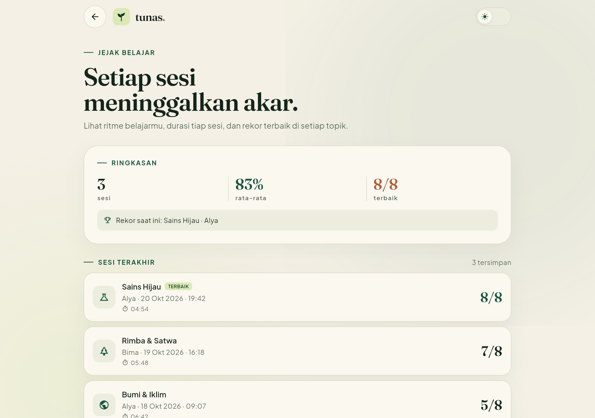
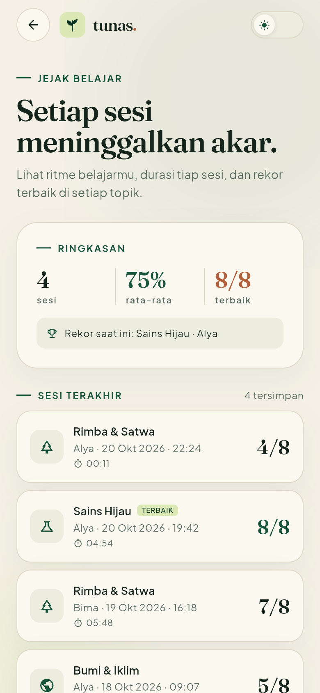
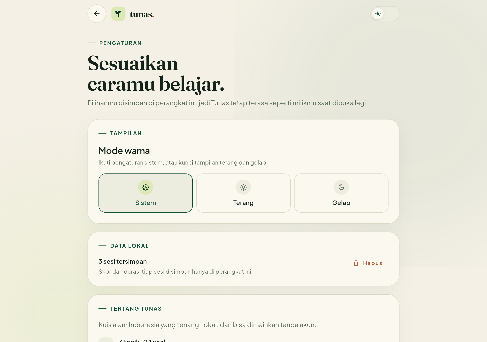
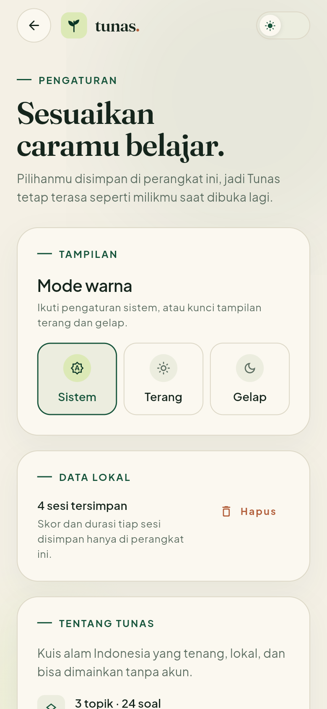
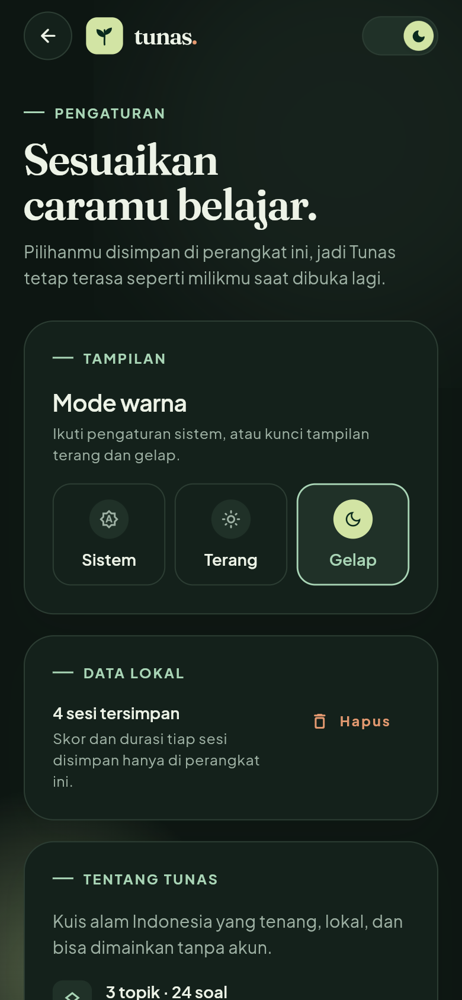

# Tunas — Kuis Alam Nusantara

Aplikasi kuis pilihan ganda bertema alam Indonesia. Dibuat dengan Flutter,
menggunakan palet hijau, tipografi Fraunces + Plus Jakarta Sans, dan tata letak
responsif untuk ponsel, tablet, maupun web.

> **Status: tahap 2 dari beberapa tahap.** Alur inti, riwayat skor lokal, dan
> pengaturan tema sudah berjalan. Fitur lanjutan tetap disisakan agar progres
> bisa dikerjakan bertahap.

## Tangkapan layar

| Mobile | Desktop |
| --- | --- |
|  |  |
|  |  |
|  |  |
|  |  |
|  |  |

Mode gelap di halaman pengaturan:


## Yang sudah ada

- Lima halaman dengan navigasi: beranda → kuis → hasil, ditambah riwayat skor
  dan pengaturan.
- Input nama, validasi sederhana, dan pilihan tiga topik.
- 24 soal pilihan ganda beserta pembahasan singkat di halaman hasil.
- Durasi sesi dihitung dan ditampilkan pada kartu hasil.
- Riwayat skor, durasi, dan rekor terbaik disimpan lokal lewat
  `shared_preferences`; maksimal 50 sesi terakhir.
- State sesi memakai `provider` + `ChangeNotifier`; jawaban, nama, dan posisi
  soal tetap aman saat layar diputar atau saat keluar-masuk halaman kuis.
- Tema terang, gelap, dan “ikuti sistem”. Pilihan tema tersimpan dan dipakai
  lagi saat aplikasi dibuka.
- Tata letak responsif: satu kolom di ponsel, dua kolom di desktop, dengan
  ukuran teks dan jarak yang mengikuti ukuran layar.
- Aset gambar tekstur kontur, ikon Material, serta font kustom yang dibundel
  langsung ke dalam aplikasi.
- Tujuh pengujian untuk alur jawaban, riwayat skor, penyimpanan tema, dan
  halaman utama/pengaturan.

## Rencana tahap berikutnya

- Timer opsional per soal, beserta penanda waktu di riwayat.
- Animasi transisi dan umpan balik jawaban yang lebih kaya.
- Penambahan bank soal dan kategori baru.
- Pemeriksaan aksesibilitas menyeluruh dan pengujian di tablet fisik.
- Build APK dan deploy versi web.

## Struktur proyek

```
lib/
  core/          # tema, warna, breakpoint responsif, formatter
  data/          # bank soal lokal
  models/        # kategori, pertanyaan, entri skor
  screens/       # beranda, kuis, hasil, riwayat, pengaturan
  state/         # ThemeController, QuizController, ScoreHistoryController
  widgets/       # komponen UI yang dipakai berulang
assets/
  fonts/         # Fraunces + Plus Jakarta Sans (OFL)
  images/        # tekstur kontur
docs/screenshots/
tool/            # skrip pembuat aset font dan tekstur
test/
```

## Menjalankan

```bash
flutter pub get
flutter run
```

Pemeriksaan proyek:

```bash
flutter analyze
flutter test
flutter build web
```

## Catatan teknis

- Tidak ada backend atau database. Soal, progres sesi, dan riwayat semuanya
  berada di perangkat.
- Progres sesi yang sedang berjalan masih disimpan di memori aplikasi.
  Riwayat sesi yang sudah selesai disimpan ke `shared_preferences`, sehingga
  tetap ada setelah aplikasi dibuka ulang.
- `QuizController` ditempatkan di atas `MaterialApp`, sehingga state tidak
  hilang ketika berpindah route atau terjadi rotasi layar.
- Font Fraunces dan Plus Jakarta Sans dilisensikan di bawah SIL Open Font
  License. Berkas lisensi tersedia di `assets/fonts/`.
- Tekstur kontur dihasilkan ulang lewat `python tool/build_assets.py`.
