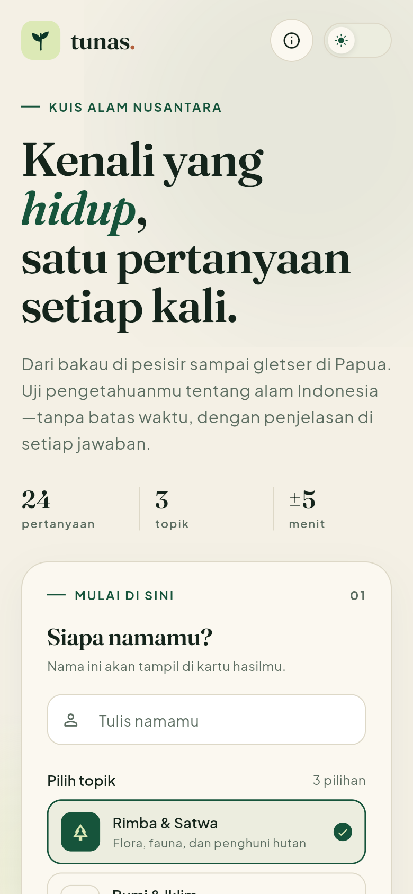
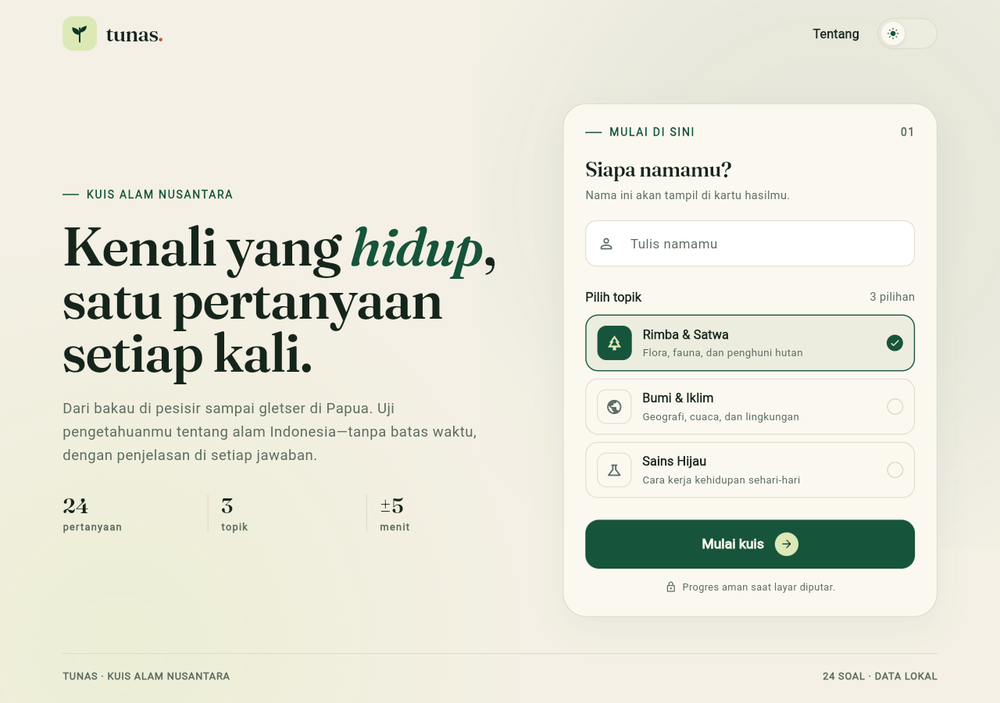
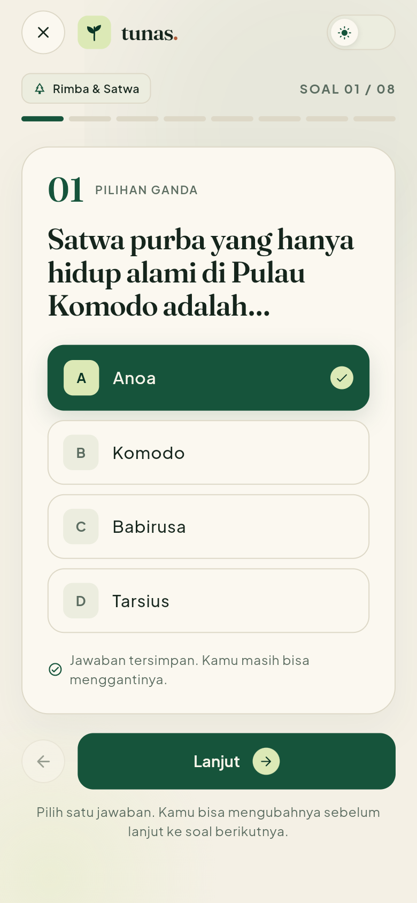
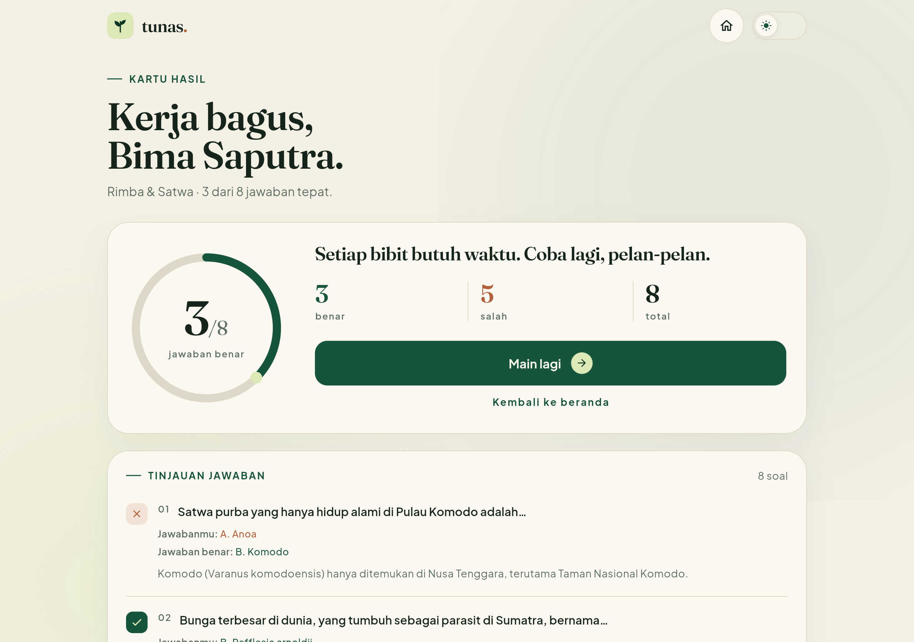
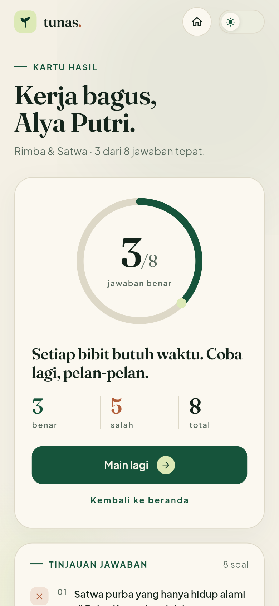
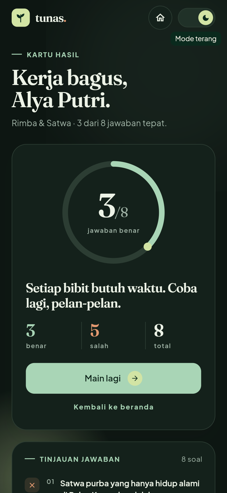

# Tunas — Kuis Alam Nusantara

Aplikasi kuis pilihan ganda bertema alam Indonesia. Dibuat dengan Flutter,
menggunakan palet hijau, tipografi Fraunces + Plus Jakarta Sans, dan tata letak
responsif untuk ponsel, tablet, maupun web.

> **Status: tahap 1 dari beberapa tahap.** Alur inti sudah bisa dimainkan.
> Fitur lanjutan sengaja belum dikerjakan agar progres bisa dilanjutkan
> bertahap.

## Tangkapan layar

| Mobile | Desktop |
| --- | --- |
|  |  |
|  |  |
|  |  |

## Yang sudah ada

- Tiga halaman dengan navigasi: beranda → kuis → hasil.
- Input nama, validasi sederhana, dan pilihan tiga topik.
- 24 soal pilihan ganda beserta pembahasan singkat di halaman hasil.
- State sesi memakai `provider` + `ChangeNotifier`; jawaban, nama, dan posisi
  soal tetap aman saat layar diputar atau saat keluar-masuk halaman kuis.
- Tema terang dan gelap yang bisa diganti dari setiap halaman.
- Tata letak responsif: satu kolom di ponsel, dua kolom di desktop, dengan
  ukuran teks dan jarak yang mengikuti ukuran layar.
- Aset gambar tekstur kontur, ikon Material, serta font kustom yang dibundel
  langsung ke dalam aplikasi.
- Unit test untuk alur jawaban dan widget test untuk halaman beranda.

## Rencana tahap berikutnya

- Riwayat skor terbaik yang disimpan secara lokal.
- Timer opsional per soal dan halaman pengaturan.
- Animasi transisi serta umpan balik jawaban yang lebih kaya.
- Penambahan bank soal dan kategori baru.
- Pemeriksaan aksesibilitas dan pengujian di tablet.
- Build APK dan deploy versi web.

## Struktur proyek

```
lib/
  core/          # tema, warna, breakpoint responsif
  data/          # bank soal lokal
  models/        # model kategori dan pertanyaan
  screens/       # beranda, kuis, hasil
  state/         # ThemeController dan QuizController
  widgets/       # komponen UI yang dipakai berulang
assets/
  fonts/         # Fraunces + Plus Jakarta Sans (OFL)
  images/        # tekstur kontur
docs/screenshots/
tool/            # skrip pembuat aset font dan tekstur
test/
```

## Menjalankan

```bash
flutter pub get
flutter run
```

Pemeriksaan proyek:

```bash
flutter analyze
flutter test
flutter build web
```

## Catatan teknis

- Tidak ada backend atau database. Seluruh soal dan progres berada di memori
  aplikasi selama sesi berjalan.
- `QuizController` ditempatkan di atas `MaterialApp`, sehingga state tidak
  hilang ketika berpindah route atau terjadi rotasi layar.
- Font Fraunces dan Plus Jakarta Sans dilisensikan di bawah SIL Open Font
  License. Berkas lisensi tersedia di `assets/fonts/`.
- Tekstur kontur dihasilkan ulang lewat `python tool/build_assets.py`.
